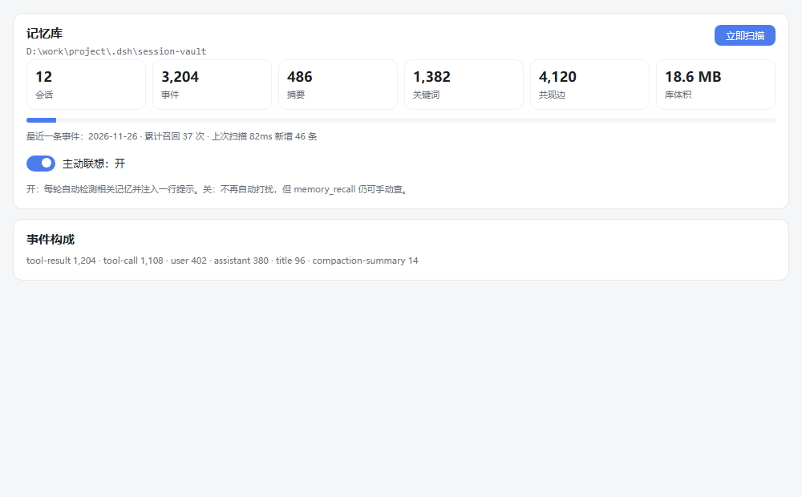
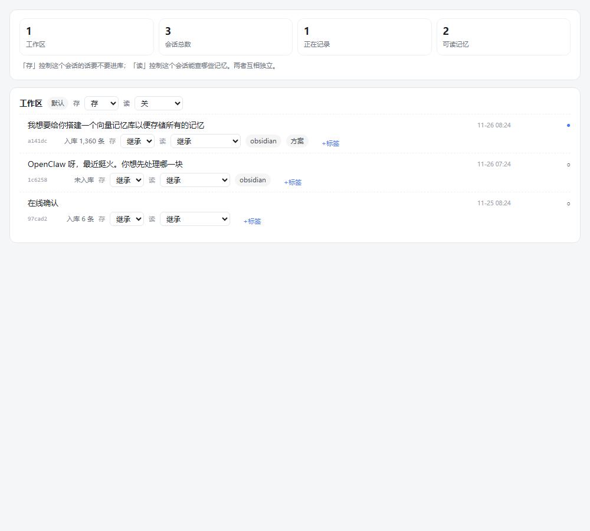

# dsh-session-vault

声明：插件制作和项目上传均由dsh完成，如有不当或不对的地方可以提建议给作者
DeepSeek Harness 的**会话长期记忆库**。把历史对话存进本地 SQLite，按
「关键词 → 摘要 → 原文」三层检索，让你能问出"很久之前那件事"。

- **零运行时依赖** —— 只用 Node 内置的 `node:sqlite` 与 `node:zlib`
- **无遗忘** —— 原文只增不删，没有 TTL / 衰减 / 回收站
- **分会话可控** —— 每个会话独立设置「是否入库」和「读取范围」
- **不打断对话** —— 任何失败静默降级，绝不阻塞 DSH 启动

> 需要 Node ≥ 24（`node:sqlite`）。DSH 桌面版自带 v24，无需另装。

## 它解决什么

模型在长会话里会经过压缩，早期细节只剩摘要；换到新会话时更是**零记忆**。

这个插件在本地把原文留全，并在你提到旧事时，把"库里有几条相关的"作为一行提示
（约 50 token）送进系统提示，让模型自己决定要不要展开原文。

## 安装

**这个包没有发布到 npm**，从 [Releases](https://github.com/OvCATTTTT/dsh-session-vault/releases/latest) 下载 `.tgz` 后再装：

```bash
dsh plugin --profile <你的profile> add "file:<下载目录>/dsh-session-vault-0.5.0.tgz"
```

> ⚠️ 不要用 `dsh plugin add <本地目录>` —— pnpm 会建 `link:` 软链接，之后一执行 `remove`
> 就会把源码目录一起删掉。详见 [docs/packaging.md](docs/packaging.md)。

装好后插件会自动扫描 `~/.dsh/sessions`、把所有会话**登记**进来（标题、时间、事件数），
但**默认不存也不读** —— 要你自己把某个会话的「存」打开，它的事件和摘要才真正入库。

## 给模型用的工具

| 工具 | 作用 |
|---|---|
| `memory_recall` | 查摘要层，返回带 `#id` 的条目 |
| `memory_open` | 按 `#id` 展开该摘要**覆盖的原文全文** |
| `memory_search` | 绕开关键词层，直接中文全文检索原文 |
| `memory_stats` | 库规模与状态 |
| `memory_sessions` | 会话清单及其策略 |
| `memory_policy` | 改某会话的写入 / 读取策略 |
| `memory_terms` | 看关键词库 |
| `memory_term` | 屏蔽（mute）或加权（pin）某个词 |
| `memory_scan` | 立即增量扫描 |
| `memory_switch` | 开关功能（如主动联想），立即生效并持久化 |
| `memory_migrate` | 搬迁数据目录（复制→校验→切换，失败回滚） |

## 主动联想可以随时关

「主动联想」= 每轮自动检测相关记忆并注入一行提示。它有三个开关层次：

| 方式 | 生效时机 | 持久 |
|---|---|---|
| 设置页 `autoHint` | 下次启动 | 是 |
| 对话里说「关掉自动联想」→ 模型调 `memory_switch` | **立即** | 是（存数据库） |
| `vault.setSwitch('autoHint', false)` | 立即 | 是 |

关掉之后**不会再有自动提示**，但 `memory_recall` 等工具仍可手动查——
"不打扰你"和"查不到"是两回事。

## 分会话策略：两个独立维度

| 维度 | 取值 | 含义 |
|---|---|---|
| **写入** `store` | `store` / `skip` / `inherit` | 这个会话的话要不要进库 |
| **读取** `read` | `off` / `own` / `all` / `tags:标签` / `inherit` | 这个会话能读哪些记忆 |

> **默认两个都是关的**（`store=skip`、`read=off`）。装好后必须你自己打开某个会话，
> 它才会开始记、开始查。这是刻意的：插件不该自己决定记什么。

优先级：**会话显式 > 工作区默认 > 全局默认**，解析结果物化到
`session_policy_effective` 表，运行时直接读。

`store` 和 `read` 是**互相独立**的：`store=skip` + `read=all` 是合法组合——
"这个会话别记我说的话，但你可以用别的记忆来回答我"。

`read=own` 表示**只能读本会话自己的历史**（长会话回溯用，不会串味）。
`read=tags:A,B` 表示**只读带这些标签的会话**（标签在会话页给会话打）。

### 怎么在设置页里改

推荐直接在**会话页**改：每行都有「存」「读」两个下拉，还有标签区。

也可以写进配置（DSH 按 `Config` 自动生成表单），四项是「会话/工作区 → 策略」的映射：

| 配置项 | 键 | 值 |
|---|---|---|
| `sessionStore` | 会话 id | `store` / `skip` / `inherit` |
| `sessionRead` | 会话 id | `off` / `own` / `all` / `tags:标签` / `inherit` |
| `workspaceStore` | 工作区路径 | `store` / `skip` |
| `workspaceRead` | 工作区路径 | `off` / `own` / `all` / `tags:标签` |

会话 id 用 `memory_sessions` 工具查。填好后保存设置即生效（插件在启动和保存时把
这些映射同步进 `sessions` 表）。

也可以在对话里直接说「这个会话不要记忆」，模型会调 `memory_policy` 工具改——
注意工具改的是运行期值，如果该会话也在上面的映射里出现过，下次同步会被配置覆盖。

## 改数据目录

配置里的 `dataDir` 只影响"去哪找库"。**搬家要用 `memory_migrate` 或运维页的「数据目录」**：

```
复制 → 校验（integrity_check + 表行数） → 切换 → 确认后才删旧目录
任何一步失败 → 保留旧目录、回滚，库照常可用
```

迁移成功后会在 `DSH_HOME` 写一个位置指针（`session-vault-location.json`），
**重启后自动用新路径**，不用再改配置。

## 扫描是自动的，但「记不记」由你决定

装好之后，插件在启动 8 秒后自动扫一遍 `~/.dsh/sessions` 并持续增量跟进，
不需要手动触发。**导入是增量的**，重复扫描不会重复入库。

但**默认不存不读**：扫描会登记所有会话（标题、时间、事件数），只有你自己把某个会话的
「存」打开，它的事件和摘要才会真正入库。所以第一次使用你会看到会话列表已经齐了、
但「入库」列大多是 `未入库` —— 这是设计如此。

> 早期版本（0.3.x 及以前）默认是「存 + 全库读」，装好就直接导入。0.3.4 起改成了默认全关。

代价和边界说清楚（都是实测）：

| 场景 | 耗时 | 对宿主的影响 |
|---|---|---|
| 首次全量（64 个会话） | **约 12 秒** | 逐文件让出事件循环，界面全程可用 |
| 单个最大的会话文件 | **最长约 2.8 秒** | 这一段是一次性同步块，会感到轻微卡顿 |
| 之后的增量扫描 | 通常 < 100ms | 无感 |
| 定时扫描间隔 | 300 秒 | 可由 `scanIntervalSec` 调 |

早期版本这里用的是同步扫描，首次导入 17~19 秒会**整段卡住 DSH**（Node 单线程）。
现在改成 `scanAsync()`：每导入一个文件就 `setImmediate` 让出一次，实测扫描期间
事件循环仍在正常转动（定时器 tick 28 次，同步版是 0 次）。

导入进行中可以在设置页「概览」看到进度条：`12/64 个文件 · 已入库 1234 条事件`。

**会有提示**：导入过程中每轮对话的上下文里带一行
`〔记忆库〕正在导入历史会话 12/64…`；导入完成后会给一条**一次性**通知
`〔记忆库〕首次导入完成：64 个会话、13,902 条事件…`，模型会转述给你然后这条通知就消失，
不会每轮重复。

剩下的 2.8 秒来自**单个超大文件内的原子导入**——一个文件的记录是在一个事务里
写完的，没法中途让出。要彻底消除需要把单文件导入拆成多批，但那样会破坏按轮
生成摘要的幂等性（同一轮被拆到两次扫描会生成不完整的摘要），所以先保留。

## 反复开关不会让记录变多

这是有测试保证的（`test/scan.test.js`）：

| 操作 | 结果 |
|---|---|
| store 来回切 5 轮，每轮都扫描 | 事件 / 摘要 / 关键词 / 边数**完全不变** |
| read 在 off / own / all / inherit 之间来回切 | 同上，数据零变化（只影响检索范围） |
| 连续扫描 10 次 | 同上 |
| 往已有会话文件追加新内容再扫 | 只导入**新增的 2 条**，旧内容不重复 |

幂等靠三道锁：`events.ukey` 唯一（会话+seq+类型+序号）、`summaries.hash` 唯一
（轮次+块号）、关键词 df 与边 hits 只在**新摘要**入库时累加（重复摘要直接跳过、
不触发索引）。

### 一个已知语义，需要你知道

**`store=skip` 期间说的话，事后改成 `store` 不会补录。** 因为水位（`bytes_done`）
在跳过时照常推进——否则被跳过的会话每次扫描都要重新解码一遍。

如果你要的是"先跳过、以后再补"，那得改成不推进水位或者记录跳过区间再回放。
现在没做，因为「跳过」的默认预期就是不要它。


装好后 `设置 → 记忆库` 会出现一个面板，七个标签页：

**概览** —— 会话/事件/摘要/关键词/边数、库体积、最近扫描、主动联想开关、立即扫描按钮



**会话** —— 按工作区分组，每个会话两个独立开关（存 / 读），工作区一级还能设默认值



**关键词** · **置顶** · **联想** · **记忆卡** · **运维** —— 分别是词库管理、钉住的记忆、
每轮联想记录、surfcore 记忆卡的只读视图、扫描与迁移等运维操作。

深色主题自动跟随系统（`prefers-color-scheme`）。

### 它是插槽里的 React 组件，不是 iframe

设置页里那一格是插件注册的 React 组件（`lib/client.js`，手写 `h()`，不用 JSX），
**不是 iframe** —— iframe 拿不到宿主的主题 token、明暗切换和 `ctx.locale`。

界面也能脱离 DSH 单独调：`dev/ui.html` 是同一套界面的独立版本，配合
`scripts/dev-ui.js` 起一个本地服务（复用真实 `src/routes.js`，不是玩具实现）：

```bash
node scripts/dev-ui.js --data ./dev-db
# → http://127.0.0.1:8790/dsh-session-vault/ui
```

改完 `dev/ui.html` 刷新即可，不用重启 DSH；调好之后再翻译成 `lib/client.js` 里的 `h()`。
深色预览可以用 `?theme=dark&tab=sessions` 强制。完整流程见
[docs/ui-workflow.md](docs/ui-workflow.md)。


core 不认识任何外部聊天平台。它只读 `<dataDir>/inbox/*.jsonl`。

所以接 QQ / 微信 / 贴吧都不用改 core，**写一个往 inbox 追加 JSON 行的小适配器**即可。
协议见 [docs/spool.md](docs/spool.md)。

本仓库附带了 surfcore（QQ 桥）的适配扩展：
`surfcore-extension/session-vault-bridge/` —— 把整个目录拷到
`~/.dsh/surfcore/extensions/` 下，在 surfcore 设置页「扩展」里打开即可。

## 主要配置

| 项 | 默认 | 说明 |
|---|---|---|
| `dataDir` | `<DSH_HOME>/session-vault` | 数据目录 |
| `autoHint` | `true` | 每轮自动检测并注入记忆提示 |
| `hintThreshold` | `0.35` | 提示触发阈值，越高越严格 |
| `hintMaxItems` | `3` | 最多提示几条 |
| `injectBoundaryNotice` | `true` | 常驻"记忆边界"声明 |
| `storeReasoning` | `false` | 保存模型思考过程（体积大） |
| `storeSystem` | `false` | 保存系统提示词（重复度高） |
| `termMinDf` | `2` | 关键词入词库的最小出现次数 |
| `ftsMaxChars` | `20000` | 每条事件进全文索引的最大字符数 |
| `spreadDepth` | `2` | 关键词联想扩散跳数 |

完整清单见 `src/index.js` 的 `Config`。

## 开发

```bash
node --test "test/*.test.js"     # 136 个单测，零依赖
node scripts/smoke.js            # 拿真实会话目录跑一遍导入 + 检索
```

`src/core.js` 及其依赖**不 import 任何 `@deepseek-ai/*`**，可以脱离 DSH 单独使用：

```js
import { SessionVault } from 'dsh-session-vault/core';

const v = new SessionVault({ dataDir: './mem', sessionsRoot: '~/.dsh/sessions' });
v.scan();
console.log(v.recall('很久以前的某件事').hits);
```

## 以后要加功能，加在哪

三个层次，按接入成本排序（详见 [docs/extending.md](docs/extending.md)）：

| 方式 | 适用 | 要改核心吗 |
|---|---|---|
| **投递箱** `<dataDir>/inbox/*.jsonl` | 接新的聊天源、导入旧档案 | 不用，写 50 行适配器 |
| **钩子** `on(HOOK.xxx, fn)` | 入库脱敏、噪声过滤、同义扩展、自定义提示措辞 | 不用 |
| **排序器** `registerRanker(fn)` | 改变结果顺序（加权/降权） | 不用 |

钩子全部是**同步 + 可失败**的：第三方钩子抛错只记一条日志然后跳过，不会影响检索和入库。

设计取舍与踩过的坑见 [docs/architecture.md](docs/architecture.md)。

## 文档

| 文档 | 内容 |
|---|---|
| **[docs/usage.md](docs/usage.md)** | **功能与使用手册** —— 有什么功能、在哪儿点、怎么配、常见任务 |
| [AGENTS.md](AGENTS.md) | 仓库约定：改代码要同步哪些文档、版本号规则、改完要跑什么 |
| [CHANGELOG.md](CHANGELOG.md) | 每个版本改了什么、为什么改，以及踩过的坑 |
| [docs/architecture.md](docs/architecture.md) | 三层数据结构、检索算法、性能取舍 |
| [docs/extending.md](docs/extending.md) | 想加功能加在哪儿（钩子 / 排序器 / 投递箱） |
| [docs/packaging.md](docs/packaging.md) | 打包安装、`dsh plugin` 的坑、从会话日志恢复项目 |
| [docs/vector-proposal.md](docs/vector-proposal.md) | 向量检索提案（**未实施**）：查证到的事实、取舍、以及到时候要避开的坑 |
| [docs/ui-workflow.md](docs/ui-workflow.md) | 设置页调试流程、UI 相关踩过的坑 |
| [docs/spool.md](docs/spool.md) | 外部程序（QQ 桥接等）怎么往库里灌数据 |

## 许可

MIT
